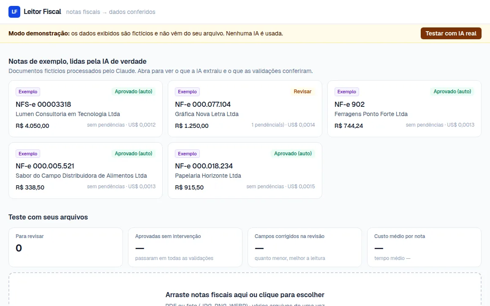
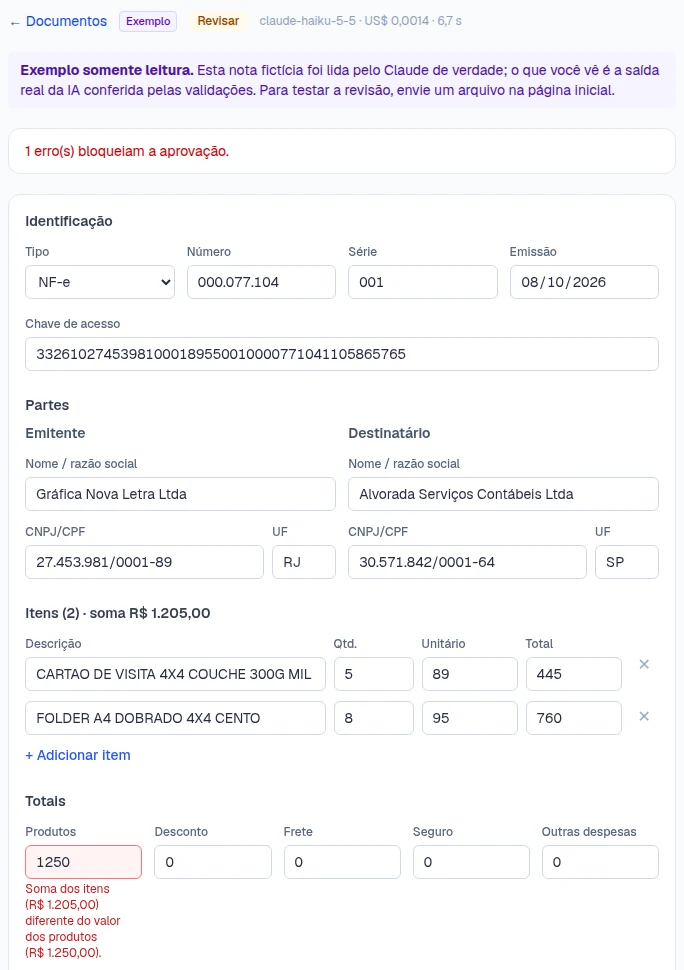

# Leitor Fiscal

Extrai dados de notas fiscais (NF-e, NFC-e, NFS-e) em PDF ou foto usando IA, **confere tudo com
regras determinísticas** e só pede revisão humana quando algo não fecha. O resultado sai em CSV
pronto para o Excel ou para importar no sistema contábil.

**[Ver a demonstração →](https://leitorfiscal.lucasmartinsdasilva.dev.br/)**



> Este repositório é a vitrine do projeto. O código-fonte é privado; veja
> [Acesso ao código](#acesso-ao-código).

## O problema

Escritórios de contabilidade ainda digitam à mão boa parte dos documentos que os clientes mandam
por e-mail e WhatsApp. É lento, caro e sujeito a erro. Só usar IA não resolve: um valor lido
errado que parece certo vai parar na contabilidade sem ninguém perceber.

## Como funciona

```
upload (PDF/foto)
   └─▶ fila (concorrência limitada)
         └─▶ Claude lê o documento e devolve JSON tipado (structured outputs + Zod)
               └─▶ validações em código, sem IA
                     ├─ tudo certo ─▶ aprovado automaticamente
                     └─ pendências ─▶ revisão humana ─▶ aprovado
                                                         └─▶ exportação CSV
```

### A IA lê; o código confere

Depois da leitura, regras determinísticas checam:

- dígito verificador de **CNPJ** (inclusive o novo **CNPJ alfanumérico**) e **CPF**;
- **chave de acesso** da NF-e (DV módulo 11) e sua coerência com CNPJ do emitente, número, série,
  mês de emissão, UF e modelo;
- **soma dos itens** igual ao valor dos produtos, e quantidade × unitário em cada item;
- **total da nota** = produtos − desconto + frete + seguro + outras + IPI + ICMS-ST;
- datas válidas e não futuras.

Erros bloqueiam a aprovação; avisos podem ser aceitos pelo revisor. O modelo é instruído a deixar
em branco o que não conseguir ler em vez de chutar, porque um campo vazio é fácil de corrigir e um
valor inventado passa despercebido.



*Nota fictícia com uma divergência impressa de propósito: a IA transcreveu o que estava no papel e
a validação barrou a aprovação.*

### Métricas no painel

| Métrica | O que mostra |
|---|---|
| Aprovadas sem intervenção | % de documentos que passaram em todas as validações |
| Campos corrigidos na revisão | compara a leitura original da IA (nunca editada) com a versão aprovada |
| Custo médio por nota | calculado pelos tokens de cada chamada |
| Tempo médio | da fila até o resultado |

## Demonstração pública com custo controlado

Cada leitura com IA custa dinheiro, então a demonstração tem três modos:

| Modo | Quem usa | O que acontece | Custo |
|---|---|---|---|
| **Demonstração** | qualquer visitante | o arquivo não é lido; dados fictícios para testar a revisão | zero |
| **Exemplo** | qualquer visitante | notas fictícias lidas pela IA **uma única vez**, somente leitura | zero por visita |
| **IA real** | quem tem código de acesso | o Claude lê o arquivo enviado | ~US$ 0,001 por nota |

- O modo atual aparece numa faixa no topo e num selo em cada documento.
- Quem quiser testar com IA real pede um código pelo próprio app. Os códigos são individuais,
  guardados só como hash, expiram em 7 dias e podem ser revogados sem reiniciar nada.
- A chave da API fica num workspace com limite de gasto mensal: mesmo com um bug, a conta não
  passa do limite.
- Cada navegador só vê os próprios documentos, e as tentativas de código são limitadas por IP.

## Decisões técnicas

- **Formato de resposta próprio para a IA.** A API de structured outputs aceita no máximo 16 campos
  com união de tipos, e a nota tem mais que isso. A IA responde só com textos (`""` quando ausente,
  valores como `"1234.56"`) e o código converte para o formato interno, com testes que garantem o
  limite.
- **Leitura original preservada.** O que a IA extraiu nunca é editado; a revisão grava uma cópia.
  É isso que permite medir quantos campos precisaram de correção.
- **Prompt ajustado com notas reais de teste.** Ex.: onde fica o CNPJ do emitente no DANFE, que
  CNPJ com letras é normal desde 2026, e observações só sobre o que o revisor precisa conferir.
- **Testes de ponta a ponta com banco real**, trocando a IA por um extrator falso: nunca chamam a
  API paga.
- **Privacidade (LGPD).** Notas fiscais têm CPF e endereço: os arquivos ficam fora do git, visíveis
  só para quem enviou, e são apagados automaticamente (24 h na demonstração, 7 dias no modo real).
  O formulário de contato pede só e-mail e mensagem.

## Stack

- **API:** NestJS 12 · Drizzle ORM · PostgreSQL · SDK oficial da Anthropic (Claude Haiku 5.5)
- **Web:** Next.js 16 · React 19 · Tailwind CSS 4
- **Testes:** Vitest (unitários das validações + e2e do fluxo completo)
- **Infra:** Docker Compose numa VPS, Nginx Proxy Manager com HTTPS, deploy por `git push`

## Acesso ao código

O código-fonte fica num repositório privado. Se você é recrutador(a) ou tem interesse no projeto,
peça acesso pelo [LinkedIn](https://linkedin.com/in/lumartins-silva) ou pelo
[portfólio](https://lucasmartinsdasilva.dev.br/) informando seu usuário do GitHub.

## Licença

Copyright © 2026 Lucas Martins da Silva. **Todos os direitos reservados.** Textos, imagens e
diagramas desta vitrine não podem ser copiados ou reutilizados sem autorização. Veja
[`LICENSE`](LICENSE).

## Autor

**Lucas Martins da Silva** · [Portfólio](https://lucasmartinsdasilva.dev.br/) ·
[LinkedIn](https://linkedin.com/in/lumartins-silva) · [GitHub](https://github.com/lucasmartins96)
